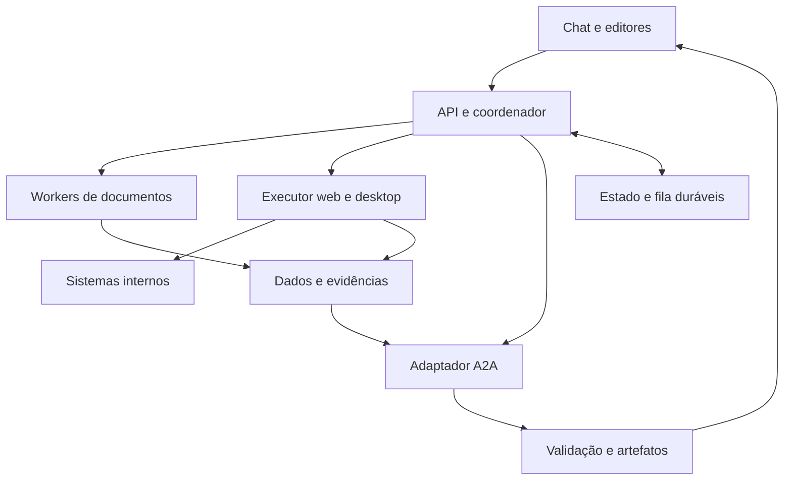

# Arquitetura de referência

## Princípio

Evoluir a aplicação existente como um produto modular. S00 confirma a stack e S01 registra a decisão. Não há obrigação de microserviços nem de reescrita. Começar com módulos bem separados e workers/executores independentes onde o isolamento e a duração das tarefas exigirem.

## Componentes e responsabilidades

| Componente | Responsabilidade |
| --- | --- |
| Interface | Chat, biblioteca, editor de artefatos, automações, prompts/guias; nenhum segredo corporativo no navegador. |
| API da plataforma | Identidade, ACL, sessões, validação de pedidos, catálogo e entrega de eventos. |
| Coordenador | Plano persistente, dependências, orçamento, fila, sequência dos arquivos e critérios de conclusão. |
| Gateway adapter | Compatibilizar A2A/JSON-RPC corporativo, autenticação, polling, contexto, cancelamento e artifacts. |
| Workers de documentos | Extração, OCR, normalização, indexação, cálculos, consultas e geração de arquivos. |
| Recuperação | Busca híbrida com autorização anterior à recuperação, ranking e evidências de origem. |
| Renderer/editor | Projeto visual estruturado, componentes controlados, validação, prévia isolada e exportação. |
| Executor web/desktop | Sessões de aplicativos, ações verificadas, downloads, checkpoints e perguntas ao usuário. |
| Persistência | Usuários, permissões, jobs, eventos, arquivos, versões, índices, memórias e registros de execução. |

O diagrama descreve responsabilidades e circulação dos resultados; não impõe um protocolo entre todos os módulos. O plano de operações deve ser validado antes de executar ferramentas e respeitar as permissões do usuário originador.

## Stack: ponto de partida condicionado ao inventário

Se compatível com o código existente, avaliar Python/FastAPI para API e processamento, frontend TypeScript/React, PostgreSQL para estado e dados, pgvector + full-text para recuperação, armazenamento de objetos ou arquivos com ACL, e workers com fila. Definir a implementação da fila em ADR com base em durabilidade, rede corporativa e operação da equipe. Redis, quando usado para coordenação, não deve ser o único repositório de progresso e resultados.

Usar bibliotecas adequadas ao formato, como Docling para documentos/OCR, leitores específicos para planilhas e um motor de consulta tabular. A escolha entre SQL, DuckDB, pandas/Polars e leitura incremental depende do volume e da stack já instalada. Não converter todas as tabelas em embeddings.

Automação web deve preferir seletores estruturais e acessibilidade, usando visão quando necessário. Automação desktop exige executor no SO compatível e sessão de usuário disponível; um servidor Linux não opera automaticamente aplicativos Windows instalados em outra máquina.

## Unidades persistentes

Uma solicitação gera um `job` local; ele pode conter muitos arquivos, etapas e tarefas remotas A2A. Manter relação explícita entre `job_id`, `step_id`, `taskId`, `contextId` e IDs de artefatos remotos. Nunca assumir que uma solicitação inteira cabe em uma única chamada ou que um timeout HTTP cancela a tarefa remota.

Separar definição versionada de automação, execução concreta e checkpoints. Separar dados originais, derivados e visualizações. Separar memória de usuário, memória de projeto e regras compartilhadas autorizadas.

## Operação e isolamento

- O worker verifica autorização antes de processar; mudanças de ACL devem invalidar acessos e caches aplicáveis.
- Downloads autenticados passam pela plataforma ou por URLs curtas e autorizadas. Nomes imprevisíveis não substituem ACL.
- Credenciais por usuário/serviço com escopo explícito; não compartilhar sessão de navegador entre usuários por conveniência.
- Código gerado, conversores e automações importadas executam com limites de CPU, memória, tempo, disco e rede adequados à tarefa.
- HTML gerado usa preview isolado e política de conteúdo; não acessar tokens/cookies da plataforma.
- Logs úteis e saneados: IDs, duração, estados, volume, códigos de erro; conteúdo sensível somente quando necessário e autorizado.
- Backups de banco, arquivos e metadados precisam ser restaurados em conjunto e testados.

## ADRs iniciais

1. Reaproveitamento da stack e limites entre módulos.
2. Identidade/SSO e escopo de compartilhamento.
3. Fila, persistência de eventos e recuperação.
4. Limites corporativos A2A, provedores de embeddings e visão.
5. Armazenamento e retenção; política de revogação e eliminação.
6. Executor web/desktop e isolamento de dependências.
7. Modelo de projeto visual e formato de pacote de automação.

Usar o [template de ADR](templates/ADR.md). Uma alternativa não avaliada não deve ser descrita como decisão já tomada.
